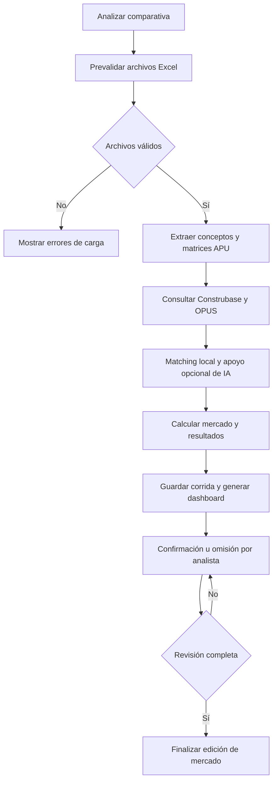

# Comparativa de proveedores · Chanix IA

La comparativa analiza los catálogos de conceptos y matrices APU de los contratistas, localiza referencias en Construbase y OPUS y calcula presupuestos de mercado. Voyage y Claude pueden asistir en la búsqueda y evaluación técnica, pero **los precios proceden de los catálogos y no son inventados por IA**.

<Info>

**Versión documentada:** V1.5.62. Esta documentación procede de la revisión del código local; no acredita las variables, llamadas ni resultados efectivos de una ejecución en Railway.

</Info>

## Navegar por la wiki

<Columns cols={3}>
  <Card title="Información general y flujo" icon="workflow" href="/comparativa/informacion-general-y-flujo">
    Desde «Analizar comparativa» hasta la creación de la corrida, dashboard y cierre de mercado.
  </Card>
  <Card title="Reglas de negocio y cálculo" icon="calculator" href="/comparativa/reglas-de-negocio-y-calculo">
    Identificación de APU, matching, unidades, fórmulas, revisión y reglas de confirmación.
  </Card>
  <Card title="Integraciones, IA y arquitectura" icon="brain-circuit" href="/comparativa/integraciones-ia-y-arquitectura">
    API de Chanix, Voyage, Claude, payloads, caché y trazabilidad.
  </Card>
</Columns>

## Recorrido del análisis

<Warning>

El análisis automático no confirma por sí solo que una referencia sea válida. El analista debe revisar y confirmar u omitir justificadamente los insumos antes de cerrar la corrida.

</Warning>
